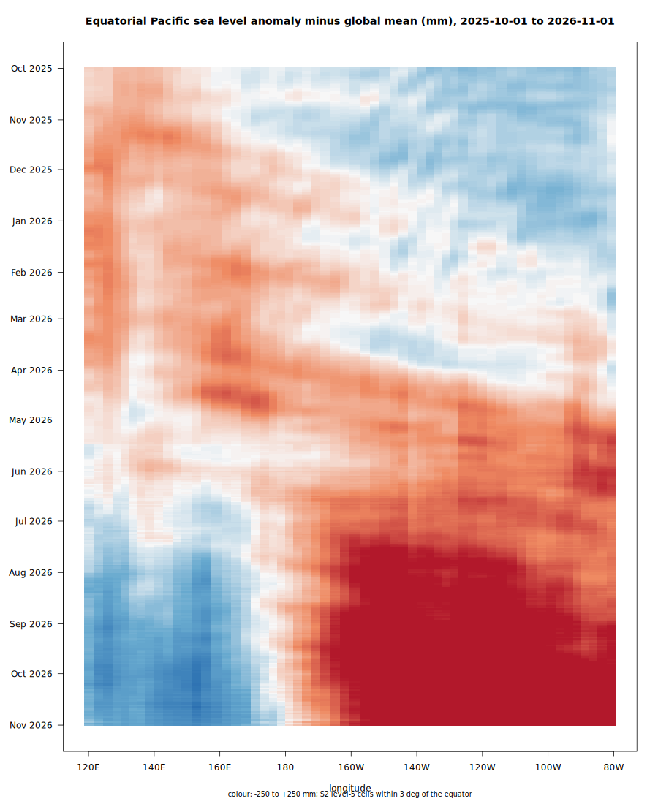

# trend.sla

Daily sea level anomaly (SLA) reduced to mergeable sufficient
statistics on S2 level-5 cells: one Parquet file per date of
`(cell, n, sumw, sumwx, sumwx2)`, from 1993 to about one day behind
real time. The second deployment of
[grist](https://github.com/hypertidy/grist), after
[trend.sst](https://github.com/mdsumner/trend.sst); this repository
holds only the product knowledge (catalog, schedule, bucket, checks).

## Source

Copernicus Marine global gridded L4 sea surface heights (DUACS,
0.125 deg, daily), read directly from the public ARCO Zarr stores
(anonymous, no download), found through
[cmemsarco](https://github.com/hypertidy/cmemsarco):

- delayed-time: `SEALEVEL_GLO_PHY_L4_MY_008_047`,
  `cmems_obs-sl_glo_phy-ssh_my_allsat-l4-duacs-0.125deg_P1D`
- near-real-time: `SEALEVEL_GLO_PHY_L4_NRT_008_046`,
  `cmems_obs-sl_glo_phy-ssh_nrt_allsat-l4-duacs-0.125deg_P1D`

Variable `sla`, metres, relative to the product's 1993-2012 reference.

## Catalog: the interleave rule

`build_catalog.sh` writes `slafiles.parquet`, one row per date in
grist's classic catalog shape (`date`, `dsn`, `band`): delayed-time
wherever it exists, near-real-time after its last date. Time axes are
read from the stores (the `time` variable carries no CF units; days
since 1950-01-01 was verified at both ends of the record). The two
grids are checked identical, since one cell mapping serves both.

When delayed-time extends, or near-real-time is reissued, the affected
dates get a new `dsn`. grist records each date's source in its sums
file and recomputes exactly the dates whose source changed: no manual
deletion. A new delayed-time version (a reprocessing) changes every
row and recomputes everything, which is correct. Note that
`cmems_catalog_data` is a bundled snapshot: a new store version needs
an updated cmemsarco (or `cmems_catalog()`) before it is picked up.

## Run (Setonix)

    sbatch backfill-sla.sh

refreshes the catalog, backfills missing and changed dates, and
publishes to `pawsey1197:aad-derived/trend-sla/` (sums, mapping,
registry, catalog, `manifest.json`). Public read:
`https://projects.pawsey.org.au/aad-derived/trend-sla/manifest.json`.

## Lessons from onboarding (all mandatory)

- **Band in the dsn.** The classic view of the store has one band per
  day (12,000+). Through the warp path that never returns. Each row
  selects its band inside the dsn (`vrt://ZARR:"...":/sla?bands=i`)
  so every read sees a one-band dataset.
- **GDAL_CACHEMAX=256 per worker.** GDAL's default block cache is a
  share of node memory per process; many workers times that OOMs the
  node. With the cap one worker is ~600 MB, flat across dates.
- **Workers equal to `--cpus-per-task`** (32: ~2.3 dates/s, the full
  record in ~75 min).
- **GDAL_LOAD_EXTRA_DIM_METADATA_DELAY=0** (classic open 8.8 s -> 1.1 s)
  and **GDAL_PAM_ENABLED=NO** (no sidecar probing on a no-LIST bucket).
- **Store chunks are (1, 512, 1024)**: mapping `band_rows = 512`, 9 GETs
  per date. Per-chunk latency is ~3 s from Setonix but parallel fetches
  don't throttle, so worker parallelism is the right answer.

`tools/forensics-zarr.sh` is the layered probe that established these
(chunking, raw HTTP, open vs read cost, band-labelling cost, engine
read under the limits).

## First light: the 2026 Kelvin wave

Daily SLA minus the daily global mean, S2 cells within 3 deg of the
equator across the Pacific (`hovmoller.sh`). The diagonal band from
January to May is the equatorial Kelvin wave that set off the 2026
El Nino: it crosses 160E in mid-March and reaches the South American
coast (90W) in early May, ~12,000 km in ~50 days, about 2.8 m/s, the
expected speed of a first-mode Kelvin wave. From July the east
Pacific stays high and the west drains: the El Nino seesaw.

## Checks

- `oracle.sh`: 1997-11-15, peak of the 1997/98 El Nino. Passed: the
  positive equatorial tongue in the central-eastern Pacific, the drained
  warm pool in the west, and the late-1997 positive Indian Ocean Dipole.
- `check_gmsl.sh`: the daily global mean of the cell sums against the
  published altimetry record. Passed on 1993-01-01..2026-05-15:
  3.16 mm/yr (published ~3.1-3.3), upward curvature, annual cycle, the
  1997/98 and 2015/16 peaks. Open question: the series averages about
  +25 mm over 1993-2012 rather than ~0; to check against the product's
  reference convention before encoding as an expectation.

## Acknowledgments

Data: E.U. Copernicus Marine Service Information. This work uses
resources of the Pawsey Supercomputing Research Centre, with funding
from the Australian Government and the Government of Western
Australia.
